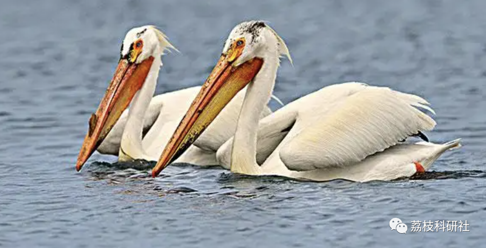
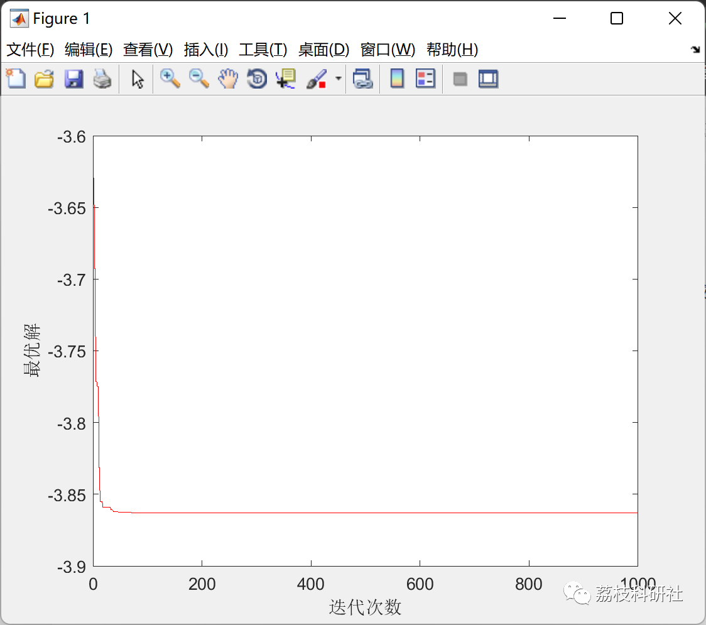
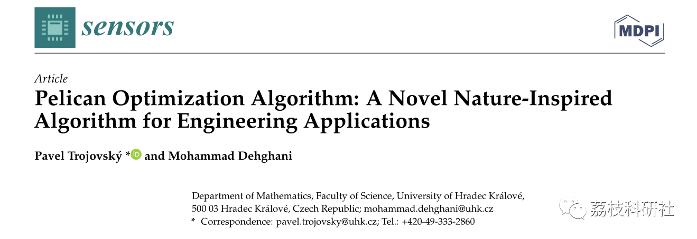

# [Optimization Algorithm]Pelican Optimization Algorithm (POA) (Matlab Code Implementation)

💥💥💥💞💞💞 Welcome to this blog❤️❤️❤️ 💥💥💥
🏆 Bloggers' Advantages: 🌞🌞🌞 The content of the blog strives for rigorous thinking and clear logic to facilitate readers.
⛳️ Mantra: A journey of a thousand miles is begun by taking a step at a time.
Litchi Research Society
Code Collection: Electrical Systems, Intelligent Algorithms and Applications, Neural Network Prediction, Path Planning, Optimized Scheduling, Workshop Scheduling, Image Processing, Signal Processing...
🎁 Special Section Links:
🌈🌈🌈🌟🌟🌟 Electrical Code Intelligent Algorithms and Their Applications Path Planning Neural Network Prediction Optimized Scheduling Image Processing Workshop Scheduling Signal Processing Romantic Her Thoughts Math Modeling Complete Code Issues
💥1 Overview
Pelicans are large birds with a long beak, a large bag in their throat used for capturing and swallowing prey. These birds enjoy group living and social life, often found in flocks of hundreds. The appearance of pelicans is as follows: their weight ranges from 2.75 to 15 kilograms, height from 1.06 to 1.83 meters, wingspan from 0.5 to 3 meters [26]. Pelicans primarily feed on fish, rarely on frogs, sea turtles, and crustaceans; if they are very hungry, they even eat seafood [27]. Pelicans hunt together. After determining the location of the prey, they dive down from 10–20 meters high. Of course, some species also watch from lower heights. Then, they spread their wings above the water surface, forcing the fish into shallow waters, making it easy for them to catch fish. When fishing, a significant amount of water enters the pelican's beak, and before swallowing the fish, it moves its head forward to remove excess water.
The hunting behavior and strategy of pelicans is a clever process that makes these birds skilled hunters. The main inspiration for the proposed POA design comes from modeling the strategy mentioned above.
📚2 Run Results
🎉3 References
🌈4 Matlab Code and Article Details Explanation
Click the article below left bottom to read more

## Images

<!-- PAYMENT_BLOCK -->

## Get this dataset

- Payment link (Stripe): [Buy now](https://buy.stripe.com/3cs8yP7sY87d0vu9AB)
- Payment QR code: 

<!-- /PAYMENT_BLOCK -->
